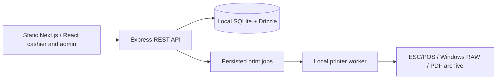

# D4NGER POS — Master Roadmap & Evidence Review

**Scope:** Windows runtime package `D4NGER POS.rar`, and 11-page visual walkthrough `Screens.pdf`.  
**Review date:** 2026-10-09 · **Build:** v1.0.1 · **Commit:** `96c7d7cc7924060b2c314b1876032c615572897d` · **Build timestamp:** 2026-09-25T11:46:01Z.

> This is the definitive **current-state roadmap for the supplied evidence**, not a release-signoff certificate. The RAR is a Windows deployment payload containing compiled backend and frontend files, worker, migrations, scripts, and bundled Node.js. It does not contain the full Git repository, a `Setup.exe` installer, complete tests, or actual peripheral acceptance logs.

## 1. Product direction

D4NGER POS is an **offline-capable, local-first restaurant point-of-sale solution** designed around fast cashier operations, a visual menu, flexible modifiers, held orders, manager controls, receipts, printer integration, local reports, and safe financial operations.

- **For cashiers:** visual catalog, easy user selection with on-screen PIN entry, live basket, modifiers, and hold/resume flows.
- **For managers:** colored categories, editable product/menu icons, custom media, receipt customization, shift and order history, refunds/voids, reports, and configuration transfer.
- **For engineers:** static Next.js/React frontend, Express API, SQLite/Drizzle and better-sqlite3, separate printer worker, transaction-bound financial writes, idempotency, audited corrections, and hardware side-effect safety.
- **For Windows deployment:** bundled Node runtime, Powershell helper tools, local file/database configuration, startup scheduled tasks, and browser app-mode launcher.

## 2. Evidence vocabulary

| Label | Definition |
|---|---|
| `CODE` | Behavior implemented in compiled JavaScript, SQL schema/migrations or PowerShell files of the supplied deployment bundle. This does not prove the full automated test suite passed. |
| `SCREEN` | Feature shown in the screenshots within `Screens.pdf`; this proves visual demonstration, not a reproducible hardware test. |
| `STATED` | User-reported feature that remains unverified by supplied artifacts. |
| `GATE` | Release acceptance condition needing an installer, Windows run, hardware, source repository or reproducible verification. |
| `CANDIDATE` | Future direction, not a shipped feature. |

## 3. Feature inventory

| Capability | Evidence | Proof points |
|---|---|---|
| Employee selection and on-screen PIN | CODE + SCREEN | `identity.js`; Screens p1 |
| Admin/Cashier permissions | CODE + SCREEN | `identity-middleware.js`, `app.js`; p1/p4 |
| Visual products, menu categories, category colors | CODE + SCREEN | `routes/catalog-admin.js`; p2/p6–8 |
| Built-in/auto-matched and editable custom catalog icons | CODE + SCREEN | `services/catalog-icons.js`; p8 |
| Category/product images and restaurant brand | CODE + SCREEN | `routes/catalog-media.js`, `routes/restaurant-profile.js`; p6–9 |
| Category-level modifiers with per-item override/exceptions | CODE + SCREEN | `services/effective-modifiers.js`; p2 |
| Modifier pricing and receipt phrase integration | CODE + SCREEN | `checkout.js`, `print-layout.js`; p2/p9 |
| Hold, resume, edit, cancel with reason | CODE + SCREEN | `routes/held-orders.js`; p3–4 |
| Order history, refund and void permissions | CODE + SCREEN | `routes/orders.js`, `services/order-history.js`; p4 |
| Shifts and cash movements | CODE | `routes/shifts.js`, `shifts.js` |
| Daily/shift and operations reporting | CODE + SCREEN | `routes/reports.js`; p5 |
| Receipt designer and PDF/archive worker | CODE + SCREEN | `print-layout.js`, `receipt-pdf.js`; p9–10 |
| Export/import of catalog, modifiers, icons, media, branding and layouts | CODE + SCREEN | `services/config-transfer.js`; p10–11 |
| Auto-launch services at Windows boot | CODE + SCREEN | `tools/D4NGER.Runtime.ps1`, `Launch-POS.ps1`; p5 |
| Dedicated cashier zoom +/- control | STATED | Needs UI/control confirmation and on-device test |
| One-click Windows Setup installer | STATED / GATE | Installer absent from RAR; requires final installer test |

## 4. Architecture

**Operating principles**

1. The browser is not the final authority for product pricing or persisted sales. Price-bearing information is resolved in the backend.
2. Amounts are represented using **integer piasters**, avoiding authoritative float arithmetic.
3. A sale's order, items, payment, outbox event, print-job intent, and held-order consumption are handled within a SQLite transaction boundary.
4. Repeated `checkoutRequestId` + matching fingerprint returns the original result. Reuse with a different payload responds with HTTP 409.
5. Printer interaction occurs **after the sale commits**. A print or drawer fault must not create another sale.
6. Reprints are not eligible to repulse the cash drawer. Ambiguous hardware effects are not automatically retried.
7. Roles are enforced by the backend, not by hiding frontend controls.

**Relevant code:** `app/api/dist/services/checkout.js`, `services/request-fingerprint.js`, `identity.js`, `identity-middleware.js`, `app/printer-worker/dist/worker.js`.

## 5. Security and integrity design

- **PIN hashing:** `scrypt` with randomized salt; verification uses a timing-safe compare. Code currently locks out after five failures for five minutes.
- **Session security:** session tokens have an expiry and a stored token hash; permissions include `sale`, `held.manage`, `reports.view`, `settings.manage`, `refund`, `void`, and more.
- **Sale integrity:** backend-side pricing, integer money, strict transaction boundaries and replay protection.
- **Correction trail:** paid orders are not casually edited; refund and void operations are explicit, permission-gated workflows.
- **Printer and drawer controls:** persistent jobs, stateful retries, non-duplicated drawer behavior, manual attention for uncertain physical outcomes.
- **Backup and migration:** SQLite backup/restore helpers and migration files. Online configuration imports enforce preconditions and make a database backup before replacement.

These are engineering properties visible in the package, not independent proof of security certification or live hardware acceptance.

## 6. Windows deployment evidence

The runtime is designed to serve `http://127.0.0.1:3210/` from the same machine. `D4NGER.Runtime.ps1` defines a `%ProgramData%\D4NGER POS` data root with `data/`, `backups/`, `receipts/`, `logs/`, `spool/`, and `config/`. `Launch-POS.ps1` starts the runtime, waits on `/api/health`, and opens Microsoft Edge in app mode where installed. Scheduled tasks register the API and printer worker to start at Windows boot.

**Safety caveats:** the default printer transport is `file` and drawer mode `disabled`, so printing to a physical thermal printer must be configured/tested separately. The server file falls back to `0.0.0.0` if no bind setting is present; the production PowerShell configuration explicitly uses `127.0.0.1`, which must be verified during installation.

## 7. Historical stage mapping vs. this supplied build

| Scope | Status |
|---|---|
| Stages 0–12: catalog, cart, checkout, modifiers, held orders | Present in runtime code; full previous stage test evidence unavailable |
| Stage 13: identity and permissions | Present in code + UI screenshots |
| Stage 14: shifts and cash | Present in code; on-device acceptance pending |
| Stage 15: printer/drawer | Worker present; real hardware tests pending |
| Stage 16: history, reprints, refunds and voids | Present in code + UI screenshots |
| Stage 17: reporting, audit, backups | Present in code; recovery acceptance pending |
| Product V2: admin, icons, images, receipt customization | Present in code + visual walkthrough |
| Linux Stage 18 | Historical delivery track; not proof of Windows handoff |
| **Windows v1.0.1** | Bundled runtime and startup scripts confirmed; installer / full machine signoff missing |
| Showcase and bilingual roadmap | Supplied as separate public-facing documentation, not POS application changes |

## 8. Current release status

**Current: Windows v1.0.1 — runtime present, release acceptance pending.** Do not close a newly invented stage or call the system production-certified without the authoritative source snapshot, final installer and manual acceptance evidence.

### Gate A — Install and upgrade (P0)

- [ ] Obtain the real installer/setup executable, capture SHA-256, confirm exact source/build version.
- [ ] Fresh-install on a clean Windows machine without preinstalled developer dependencies.
- [ ] Demonstrate the claimed single-action installer behavior end-to-end.
- [ ] Reboot twice; confirm background tasks and launcher work.
- [ ] Upgrade an older database to v1.0.1 preserving products, shifts, orders and media.

### Gate B — Financial and recovery safety (P0)

- [ ] Cashier login, open shift, sale with modifiers, payment, shift close and report reconciliation.
- [ ] Create/modify/resume/cancel held orders, with reason captured.
- [ ] Simulate response loss and replay the exact checkout request; verify one sale.
- [ ] Confirm Cashier cannot access admin-only report/settings/refund/void routes.
- [ ] Backup/restore with isolated test data and SQLite integrity/foreign-key checks.

### Gate C — Physical devices (P0)

- [ ] Confirm thermal printer and width, Arabic rendering, cutting, USB/TCP/RAW transport.
- [ ] Print normal, reprinted and PDF receipts and compare content to original sale.
- [ ] Confirm no drawer pulse during reprint and safe handling after uncertain pulse outcome.
- [ ] Power-loss and restart behavior for in-flight print jobs.

### Gate D — UX and packaging (P1)

- [ ] Confirm and capture UI zoom controls/behavior if offered.
- [ ] Test 1366x768 and 1920x1080, touch, keyboard and browser-only workflows.
- [ ] Measure realistic old-POS performance rather than presenting invented millisecond claims.
- [ ] Remove private customer/employee identifiers from screenshots before publishing.

### Gate E — Reproducible release source (P0)

- [ ] Obtain clean-HEAD full repository snapshot, latest external roadmap, installer-building scripts and test logs.
- [ ] Run source-level `pnpm typecheck`, `pnpm lint`, `pnpm test`, `pnpm build` at the packaged commit.
- [ ] Match installer version, build-info, Git tag and migrations; record a signed release acceptance report.

## 9. Candidate roadmap after acceptance

| Priority | Candidate | Status |
|---|---|---|
| P0 | Reproducible installer + release gate, clean rollback path | Next acceptance work |
| P1 | Zoom/UI accessibility proof and polish | Verify and refine |
| P1 | Safer update/restore diagnostics & guided recovery | Proposed `1.1` |
| P2 | Multiple tills talking to **one API and one local database**, not sharing the live `.db` | Proposed `1.2` |
| P3 | Optional branch/cloud sync using existing outbox foundations | Proposed `2.0` |

**Do not mistake an outbox table for a completed cloud-sync feature.**

## 10. Presentation & disclosure policy

Show the 19 authentic screenshots extracted from the supplied 11-page PDF; captions should identify the corresponding page. Show the easy restaurant workflows first, then explain architecture and money/hardware safety. Distinguish source-code evidence from UI screenshots and remaining installation/physical-device acceptance.

**Publishing rule:** never upload the original Windows runtime RAR, source secrets, private databases, real customer details, or hidden system files to the public showcase repository. Only publish the sanitized site, screenshots and project documentation.

**Owner:** Mahmoud Atef · **Developer profile:** `github.com/mahmoudatefdeveloper` · **Personal portfolio:** configure its final URL when provided.
