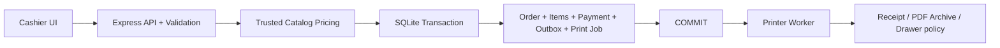

# D4NGER POS — Master Roadmap | Windows v1.0.1

> **المرجع الحالي للتوثيق والعرض — 9 أكتوبر 2026**  
> **نطاق العمل:** تقييم *Windows production payload* المرفوع في `D4NGER POS.rar` + الشاشات التوضيحية من `Screens.pdf` (11 صفحة).  
> **Build evidence:** `v1.0.1` — commit `96c7d7cc7924060b2c314b1876032c615572897d` — built at `2026-09-25T11:46:01Z` — Node `24.20.0` — pnpm `11.24.0`.  
> **مهم:** هذه **Roadmap توثيق المنتج والجاهزية الحالية**، وليست إعلان إغلاق Release بعد اختبارات كاملة؛ الأرشيف المرفوع يحتوي ملفات التشغيل المبنية لا مستودع TypeScript الكامل أو ملف Installer النهائي.

---

## 01 | الرؤية: نظام بيع حقيقي، مش مجرد شاشة كاشير

**D4NGER POS** نظام نقاط بيع للمطاعم مبني على فكرة **Local-first**: يعمل داخل ماكينة المطعم دون اشتراط إنترنت لإتمام البيع، بواجهة أيقونات واضحة للمستخدمين، وأدوات قوية للمدير لتعديل المنيو، الطلبات، الإيصالات والتقارير. يُحفظ البيع محليًا قبل محاولة طباعة الإيصال، والتعديلات الحساسة تمر عبر صلاحيات الـBackend.

### ما نريد أن يفهمه العميل

1. **سهل التعلم:** مستخدم مصوّر، لوحة أرقام PIN على الشاشة، وأصناف بأيقوناتها وصورها.
2. **سريع في الاستخدام اليومي:** تقسيم بالألوان، سلة مباشرة، إضافات مرئية، وطلبات معلّقة قابلة للاسترجاع.
3. **قابل للتخصيص:** الأقسام والألوان والأيقونات والصور، الإضافات، ومصمم الإيصالات والتوزيع والطباعة.
4. **تشغيل وإدارة:** شيفتات وصلاحيات وسجل بيع وتقارير وسلوك واضح عند الإلغاء/الاسترجاع.
5. **مناسب لبيئة المطعم:** تشغيل محلي، أدوات Windows لبدء الخدمات آليًا، حفظ نسخ احتياطية، ونظام طباعة منفصل عن اعتماد البيع.

### ما نريد أن يفهمه المهندس

**Local-first modular monolith** — تطبيق React/Next.js مبني كملفات Frontend ثابتة، Express REST API داخل Node.js، قاعدة SQLite محلية بـ `better-sqlite3` وDrizzle، وعامل مستقل للطباعة؛ مع صلاحيات، معاملات ذرّية، idempotency، ومبدأ أن آثار الأجهزة لا تُعاد بلا ضوابط.

---

## 02 | مستويات الإثبات المستخدمة في هذا المستند

| الرمز | المقصود | ما يسمح لنا نقوله |
|---|---|---|
| **CODE** | مسارات برمجية موجودة ضمن `dist/*.js` أو SQL أو PowerShell في أرشيف Windows | «الميزة موجودة برمجيًا في حزمة v1.0.1» دون ادعاء اجتياز الاختبار |
| **SCREEN** | صورة فعلية من `Screens.pdf` | «الميزة ظهرت في تجربة مصورة» دون ادعاء اختبار آلي |
| **STATED** | وصف من صاحب المشروع دون دليل مستقل كافٍ في الأرشيف | «ميزة مُبلّغ عنها؛ تحتاج إثبات قبول» |
| **GATE** | اختبار جهاز/طابعة/تثبيت أو مستودع مصادر لم يُقدَّم | «مطلوب قبل إعلان جاهزية تسليم نهائية» |
| **PLANNED** | اتجاه مستقبلي وليس ميزة مكتملة | «مرشح لنسخة قادمة» فقط |

**قاعدة الإطلاق:** وجود ملفات JavaScript مبنية أو صورة لا يساوي PASS لاختبارات typecheck/lint/test/build أو لاختبارات عتاد حقيقية.

---

## 03 | مصفوفة المنتج الحالية — للمطعم والكاشير

| المجال | الحالة الحالية | الإثبات | لماذا مهم؟ |
|---|---|---|---|
| اختيار مستخدم بصورة ثم PIN افتراضي على الشاشة | CODE + SCREEN | `identity.js`؛ Screens ص1 | دخول مباشر وواضح بدون تعقيد |
| صلاحيات Admin / Cashier مع تحقق داخل API | CODE + SCREEN | `identity-middleware.js`, `app.js`؛ Screens ص1 وص4 | واجهة مختلفة مع منع تعديلات غير مصرح بها |
| منيو أيقونات وصور، أصناف وفئات بألوان | CODE + SCREEN | `routes/catalog-admin.js`؛ Screens ص2، ص6–8 | اختيار أسرع وتقليل خطأ الصنف |
| أيقونات جاهزة واقتراح تلقائي وربط بالكلمات | CODE + SCREEN | `services/catalog-icons.js`؛ Screens ص8 | المنيو واضح حتى لمن يفضّل الرموز على القراءة |
| إضافة/تعديل أيقونات مخصصة | CODE + SCREEN | `catalog-admin.js`, `catalog-icons.js`؛ Screens ص8 | مرونة للمنيو المحلي |
| صور الفئات/الأصناف والشعار | CODE + SCREEN | `routes/catalog-media.js`؛ Screens ص6، ص9 | ظهور هوية المطعم ومحتوى بصري |
| إضافات عامة للقسم أو خاصة بالصنف واستثناءات | CODE + SCREEN | `effective-modifiers.js`, `category-modifiers.js`, `product-modifiers.js`؛ Screens ص2 | تخصيص الطلب دون الالتفاف على قواعد المنيو |
| احتساب سعر الإضافة وعرضها بتنسيق موحّد في الإيصال | CODE + SCREEN | `checkout.js`, `print-layout.js`؛ Screens ص2، ص9 | دقة في السعر وشكل الفاتورة |
| إنشاء وتعليق الطلب بسبب، استرجاعه أو إعادة تعليقه أو إلغاؤه | CODE + SCREEN | `routes/held-orders.js`؛ Screens ص3–4 | العميل يرجع فيكمل من حيث توقف |
| سجل الطلبات ومراجعة العمليات | CODE + SCREEN | `routes/orders.js`؛ Screens ص4 | تتبّع البيع اليومي |
| Refund / Void بصلاحيات واضحة | CODE؛ صور السجل | `order-history.js`, `routes/orders.js` | تصحيح مالي صريح بدل تغيير بيع مدفوع خلسة |
| فتح/إغلاق الشيفتات وحركات الصندوق | CODE | `routes/shifts.js`, `shifts.js` | ربط الشيفت بالموظف وحركة النقد |
| تقارير يومية وشيفتات ومؤشرات أصناف | CODE + SCREEN | `routes/reports.js`؛ Screens ص5 | معرفة ما بيع فعليًا |
| تكبير/تصغير واجهة الكاشير كميزة مستقلة | STATED / NEEDS QA | وصف صاحب المشروع؛ لم يُحسم من صور الأرشيف وواجهة التشغيل المبنية | يتم تأكيد عنصر التحكم وسلوكه على ماكينة فعلية |
| «تثبيت بضغطة واحدة» | STATED / NEEDS INSTALLER | وصف صاحب المشروع؛ **لا يوجد Setup.exe داخل RAR** | يُوثّق بعد تجربة الـInstaller النهائي |

**ملاحظة:** الأيقونات في الواجهة قد تكون Emoji أو صورًا/رموزًا مختارة من مكتبة النظام؛ ليست كل أيقونة بالضرورة «صورة مرسومة» من نظام رسم خارجي. الأهم أن العميل يمكنه تخصيص الظهور بصريًا، وتفاصيل الرسم/المحرك تُراجع في السورس الكامل.

---

## 04 | إدارة المنيو والتحكم من لوحة الإدارة

- الفئات: إنشاء/تعديل أسماء، ألوان خلفية، أيقونة وصورة، ترتيب وحالة تفعيل.
- الأصناف: اسم وسعر ثابت أو **Open Price** حيث تُحدد القيمة داخل ضوابط الـBackend، صورة وأيقونة وترتيب وحالة تفعيل.
- الإضافات: مجموعات واختيارات؛ `single/multiple`، حد أدنى/أقصى، فروق أسعار بالقروش، ميراث إعدادات القسم للصنف مع تجاوزات محلية.
- الأيقونات: مفاتيح جاهزة وأيقونات مخصصة مع `autoKeywords` لتسهيل الترشيح حسب الاسم.
- الطباعة: شعار، اسم المطعم وشعاره النصي، بيانات التواصل، ظهور الحقول، ارتفاعات الخطوط، الهوامش، ترتيب الأقسام، فواصل الجدول وتوزيع الأعمدة.
- نقل إعدادات المنيو وتصميم الطباعة إلى جهاز آخر بصيغة `.d4pos-config` وفق قواعد تحقق وأمان أثناء الاستيراد.

**صور الاستخدام:** شاشة المنيو ص2؛ المحرر ص6–7؛ مكتبة الأيقونات ص8؛ الإيصالات ص9–10؛ النقل ص10–11.

---

## 05 | تدفق البيع — لماذا لا نكتفي بضغطة Checkout؟



**الحقائق الموجودة في الحزمة:**

1. الكود يعيد حساب سعر المنتج والإضافات من بيانات خاضعة للـBackend ويخزن المال بوحدات **القرش الصحيح (`piasters`)**.
2. `sqlite.transaction(...)` يجمع كتابات البيع الأساسية المرتبطة بالطلب والدفع والـOutbox ومهمة الطباعة، واستهلاك الـHeld Order عند الحاجة.
3. `checkoutRequestId` مرتبط بـrequest fingerprint: نفس المفتاح ونفس البيانات يعيد نتيجة سابقة، والمفتاح نفسه مع بيانات مختلفة ينتج `409`.
4. «البيع المدفوع» لا يتغير اعتباطيًا؛ توجد طرق إلغاء/استرجاع واضحة مع سجل وتحقق صلاحيات.
5. بعد اعتماد البيع، الـPrinter Worker يتعامل مع مهمة الطباعة مستقلًا؛ تعطل الجهاز لا يستدعي إنشاء بيع جديد.

**ملفات الأدلة:** `app/api/dist/services/checkout.js`, `app/api/dist/services/request-fingerprint.js`, `app/api/dist/services/order-history.js`, `app/printer-worker/dist/worker.js`.

---

## 06 | الأمان والصلاحيات والسلامة المالية

| الحماية | التفسير التقني في نسخة Windows |
|---|---|
| PIN محمي | `scrypt` مع Salt عشوائي؛ مقارنة `timingSafeEqual`، قفل لمدة 5 دقائق بعد 5 محاولات فاشلة وفق الكود الحالي |
| الجلسات | رموز جلسات لها انتهاء؛ تخزين بصمة الرمز بدلاً من الرمز الخام في قاعدة البيانات |
| Backend Authorization | Middleware يتحقق من الصلاحيات على Route، وليس مجرد إخفاء زر من الواجهة |
| بيانات مالية صحيحة | التعامل بالقروش الصحيحة والتحقق من السعر مرة ثانية على السيرفر |
| عدم تكرار البيع | Idempotency key + fingerprint + conflict response |
| Transaction ذرّية | إما حفظ البيع المرتبط بالكامل أو rollback |
| تصحيح تاريخي صريح | Refund/Void منفصلان ومربوطان بالبيع الأصلي وصلاحية منفّذه |
| حدود للطابعة | إعادة طباعة الإيصال لا تعيد نبضة فتح الدرج، والحالة الفيزيائية الغامضة لا تُعاد تلقائيًا |
| Backup | وظائف إنشاء نسخة SQLite ومراجعتها والاسترجاع وفق سياسات التطبيق |
| نقل الإعدادات الآمن | قبل الاستيراد: تحقق من الصيغة، منع وجود شيفت أو طلبات معلّقة فعالة، نسخة احتياطية، Transaction وتحقق سلامة |

**تقييد مهم:** هذه ضمانات تصميمية موثقة في الكود المرفوع، وليست تقرير Penetration Test أو شهادة أمن مستقلة.

---

## 07 | الطباعة والإيصالات والكاش دراور

**المنفذ برمجيًا:** العامل `printer-worker` يكوّن الإيصالات، يدعم ESC/POS وتوليد PDF أرشيفي، ويحتفظ بحالات الطباعة وإعادة المحاولة. مصمم الإيصالات يسمح بتغيير الحجم والمحاذاة والهوامش، ترتيب الأقسام وظهور المعلومات وخطوط الفصل، بينما Preview يظهر في لوحة الإدارة (صور ص9–10).

**فكرة الأمان المهمة:** عملية الكتابة إلى الطابعة أثر مادي وقد تنجح حتى لو فشل الرد. لذلك العامل يميز بين حالات `pending`, `printing`, `printed`, `failed` وحالات الدرج مثل `pending`, `armed`, `completed`, `unknown`. عند عدم التأكد من نتيجة نبضة الدرج، لا يعيدها تلقائيًا.

**أمان افتراضي في حزمة Windows:** الإعداد الافتراضي في `tools/D4NGER.Runtime.ps1` هو `POS_PRINTER_TRANSPORT=file` و`POS_DRAWER_MODE=disabled`. أي أن وجود الـWorker لا يثبت تلقائيًا أن الطابعة الفيزيائية أو الدرج قد اجتازا اختبار الجهاز؛ ينبغي تهيئة Windows Spooler/RAW helper واختبار العتاد الحقيقي.

---

## 08 | معمارية وتشغيل Windows — الحالة الموثقة

```text
Windows machine
 ├─ Desktop / Browser (Edge App mode)
 │    └─ http://127.0.0.1:3210/
 ├─ Scheduled Task: D4NGER POS API
 │    └─ Node 24 + Express + static Next.js frontend
 ├─ Scheduled Task: D4NGER POS Printer
 │    └─ ESC/POS / RAW Spooler / PDF archive worker
 ├─ ProgramData\D4NGER POS\
 │    ├─ data\restaurant-pos.db
 │    ├─ backups\
 │    ├─ receipts\
 │    ├─ logs\
 │    ├─ spool\
 │    └─ config\pos.env
 └─ tools\D4NGER-POS-Maintenance.ps1
```

- تطبيق **محلي**؛ إعداد التشغيل الفعلي في PowerShell يحدد الـBind بـ `127.0.0.1`.
- أداة `Launch-POS.ps1` تبدأ الخدمات، تنتظر نتيجة `/api/health` ثم تفتح Edge في وضع تطبيق أو المتصفح الافتراضي.
- `Register-D4Tasks` ينشئ مهمتي Windows عند بدء التشغيل بحساب SYSTEM، ويضبط محاولة إعادة البدء عندما تفشل المهمة.
- الملفات التشغيلية مفصولة عن البيانات القابلة للكتابة داخل `%ProgramData%\D4NGER POS`.
- لا يحتاج Docker على ماكينة العميل في تصميم الحزمة.
- يحتوي الأرشيف على Node Runtime مضمن وملفات `dist` وStatic Frontend، لكنه **لا يحتوي Setup.exe ولا ملفات المصدر والاختبارات الكاملة**.
- `server.js` لديه fallback عام `0.0.0.0` إذا لم يمرر إعداد البيئة؛ لذلك يجب التحقق دائمًا من وجود إعداد التشغيل المقيد بـLoopback عند التثبيت.

---

## 09 | سجل مراحل التنفيذ مقابل الأرشيف الحالي

| المرحلة | مضمونها | تقييم الأدلة الحالية |
|---|---|---|
| Stages 0–12 | Core catalog, cart, modifiers, checkout, held orders, quality | الوظائف الأساسية موجودة في حزمة التشغيل، لكن لا يوجد اختبار Stage Gate في الأرشيف |
| Stage 13 | PIN Users & Roles | موجود في الكود وصور الدخول |
| Stage 14 | Shifts & Cash | موجود في Routes/Schema؛ يحتاج Smoke Test |
| Stage 15 | Receipt printer, cash drawer | موجود في Worker؛ قبول طابعة ودرج فعليين ما زال Gate |
| Stage 16 | Order history, reprint, refund/void | موجود في الكود وصور السجل؛ القبول النهائي يحتاج بيانات تجربة |
| Stage 17 | Reports, audit, backups | موجود في الكود وصورة التقارير؛ Restore يحتاج تجربة |
| Product V2 | Admin, catalog icons, images, receipts/PDF | موجود في الكود وصور متعددة |
| Stage 18 Linux | Lubuntu handoff | موجود كمرجع تاريخي؛ **ليس دليلاً على Windows الحالي** |
| Windows v1.0.1 | Bundle, scheduled tasks, launcher, maintenance | موجود ضمن الأرشيف؛ Installer/Restart/Printer acceptance ما زال Gate |
| Showcase & Documentation | موقع عربي/English وصور حقيقية وRoadmap | **مُنجز كحزمة توثيق وعرض موازية**؛ ليس تعديلًا في برنامج الكاشير |

---

## 10 | الوضع الحالي الحقيقي: أين نقف؟

**Current: Windows v1.0.1 — Runtime available / Release acceptance pending.**  
ليس من الدقة تسميته «Stage 19 مكتملة» أو «production-certified» بدون أحدث Roadmap خارجية ومستودع سورس كامل أو تقرير الاختبارات النهائي. النسخة المرفوعة تثبت البناء التشغيلي وخيارات التشغيل، والصور تثبت أن واجهات رئيسية استُعرضت على Windows.

### Gate A — إثبات الحزمة والمثبت (P0)

- [ ] الحصول على **Setup.exe** النهائي وملف التثبيت/الإنشاء إن توفر، وتوثيق SHA-256 والإصدار.
- [ ] تثبيت نظيف من Windows دون تثبيت Node أو Docker أو أدوات مطور مسبقًا.
- [ ] تجربة One-click / guided install من أول نقرة وحتى شاشة الدخول بدون خطوات خفية.
- [ ] التحقق من تسجيل Tasks والبدء تلقائيًا بعد Restart مرتين.
- [ ] تأكيد المسارات وفصل ملفات التطبيق عن SQLite والنسخ والإعدادات.
- [ ] تجربة ترقية v1.0.0 → v1.0.1 دون ضياع قائمة/صور/شيفتات/أوردرات.

### Gate B — قبول بيع وأمان وتخزين (P0)

- [ ] فتح شيفت، بيع بأصناف وإضافات، دفع نقدي، وإغلاق ومطابقة التقارير.
- [ ] تعليق أوردر مع سبب، استرجاعه وتعديله وبيعه؛ وتجربة إلغائه بالسبب.
- [ ] إعادة إرسال نفس `checkoutRequestId` بعد فصل الرد: **بيع واحد فقط**.
- [ ] التحقق من منطق غير المصرح له: دخول Cashier لا يسمح Refund/Void/Reports/Settings.
- [ ] فشل/انقطاع الطابعة بعد COMMIT لا يحذف أو يضاعف البيع.
- [ ] إنشاء Backup، اختباره، ثم Restore في بيئة اختبار غير بيانات العميل.
- [ ] ترقية قاعدة قديمة وفحص `PRAGMA integrity_check` و`foreign_key_check`.

### Gate C — قبول الطابعة والدرج على جهاز العميل (P0)

- [ ] تحديد موديل الطابعة، عرض الورق، الترميز العربي، Driver/USB/Network.
- [ ] طباعة إيصال عربي فعلي وقصه، مع الإضافات والاسم المخصص واللوجو.
- [ ] طباعة تقرير/إعادة طباعة وعدم فتح الدرج عند Reprint.
- [ ] اختبار انقطاع التيار/الطابعة أثناء Pulse والتأكد من عدم إعادة نبضة غامضة.
- [ ] مطابقة إيصال PDF/Archive مع الطلب الصحيح دون وصول خاطئ لملفات جهاز آخر.

### Gate D — UX والمظهر (P1)

- [ ] إثبات عنصر تكبير/تصغير الواجهة وطريقة حفظ التفضيل؛ تصوير شاشة الدليل.
- [ ] اختبار وضوح العناصر والأيقونات لضعف النظر ومقاسات 1366×768 و1920×1080.
- [ ] تجربة باللمس ولوحة المفاتيح ودون إنترنت بعد Restart.
- [ ] التأكد من أداء الفئات الكبيرة والصور على جهاز POS ضعيف فعليًا؛ لا ننشر أرقام سرعة دون قياس.
- [ ] أخذ لقطات نظيفة لنسخة Demo بلا بيانات أشخاص حقيقيين لنشر الموقع.

### Gate E — Source & Release Integrity (P0)

- [ ] أحدث full source snapshot مع branch/HEAD/clean tree، الـRoadmap الرسمية وسكربتات build والـInstaller.
- [ ] `pnpm typecheck`, `pnpm lint`, `pnpm test`, `pnpm build` على نفس الـcommit.
- [ ] التحقق من إصدار ملفات `build-info.json` والـInstaller والـGit tag.
- [ ] مقارنة الأدلة مع اختبارات Restore/QA وأجهزة الطباعة قبل إعلان Release Accepted.

---

## 11 | اتجاهات الإصدارات القادمة — اقتراحات لا وعود

| الأولوية | الاقتراح | لماذا؟ | الحالة |
|---|---|---|---|
| P0 | استكمال Windows acceptance وتجهيز Installer قابل لإعادة الإنتاج | توثيق «ضغطة واحدة» بشكل قابل للإثبات | Next release gate |
| P1 | UX Accessibility + واجهة قابلة للتكبير مؤكدّة ومصورة | كاشير سريع لمختلف الأعمار والأجهزة | Verify / refine |
| P1 | Update / rollback وRecovery موثقان | دعم فني أقل خطورة | Candidate `1.1` |
| P1 | أداة Diagnostic report لا تحتوي أسرار | تشخيص جهاز المطعم دون الدخول للبيانات | Candidate |
| P2 | عدة Terminals عبر API واحد وقاعدة SQLite محلية للسيرفر | توسعة مطعم يحتاج أكثر من كاشير | Candidate `1.2` |
| P3 | Cloud Sync اختيارية مبنية على Outbox | فروع ومتابعة من بعيد مع استمرار Offline | Candidate `2.0` |

**مهم:** وجود جدول `outbox_events` لا يعني أن Cloud Sync تعمل الآن، كما أن وجود ملف Worker لا يغني عن إثبات الطباعة على Hardware العميل.

---

## 12 | خطة عرض المنتج للجمهور — Marketing & Engineering

**العميل أولاً:** شاشة الكاشير الحقيقية → الأيقونات والألوان → الإضافات → تعليق الطلب → إدارة المنيو → تصميم الإيصال → التقارير → جاهزية Windows. اعرض فائدة كل خطوة بلغة مباشرة، مع صورة مُسندة لمصدرها.

**ثم التقنية:** Architecture → Checkout Transaction → Idempotency → Permissions → Printer/Door side effects → Backups → Release Evidence. استخدم أمثلة وملفات مصدر وملاحظات شفافة عن الاختبارات التي لم تُنجز.

**صور دليل الشاشات:** `Screens.pdf` صفحة 1 (الموظفون وPIN)، 2 (المنيو/الإضافات)، 3–4 (التعليق والسجل)، 5 (التقارير وبدء تشغيل Windows)، 6–8 (Admin والأيقونات)، 9–10 (الإيصالات ونقل الإعدادات)، 11 (الشرح النصي لنقل الإعدادات).

**تنبيه النشر:** لا ترفع `D4NGER POS.rar` أو ملفات قواعد بيانات أو أسرار على GitHub Pages. ارفع فقط `website/` والمستندات والصور المُعدّة للنشر. زر Portfolio يستبدل برابط الموقع الشخصي عند توافره؛ يمكن استخدام GitHub الشخصي كوجهة بديلة مؤقتًا.

---

## 13 | قائمة أدلة موجزة

- `D4NGER POS.rar / build-info.json` — الإصدار والـcommit ووقت البناء.
- `D4NGER POS.rar / tools/D4NGER.Runtime.ps1` و`Launch-POS.ps1` — تشغيل Windows والـTasks والبيانات.
- `D4NGER POS.rar / app/api/dist/app.js` — Routes/Authorization/Static Frontend.
- `D4NGER POS.rar / app/api/dist/identity.js` — PIN/session/roles.
- `D4NGER POS.rar / app/api/dist/services/checkout.js` — البيع وidempotency/Transaction.
- `D4NGER POS.rar / app/api/dist/services/effective-modifiers.js` — الإضافات الموروثة والتخصيص.
- `D4NGER POS.rar / app/api/dist/services/config-transfer.js` — نقل الإعدادات والاستيراد الاحتياطي.
- `D4NGER POS.rar / app/printer-worker/dist/worker.js` و`print-layout.js` — الطابعة والدرج ومصمم الإيصالات.
- `D4NGER POS.rar / app/api/drizzle/*.sql` — 26 Migration من `0000` إلى `0025`.
- `Screens.pdf` — صور الواجهة الحقيقية مرتبة حسب الصفحات أعلاه.

> **نتيجة المراجعة:** المشروع غني وظيفيًا ويحتوي قرارات هندسية واعية؛ التوصية الحالية هي **توثيق Windows Runtime v1.0.1 على أنه جاهز لمرحلة قبول العميل، وليس الإعلان أنه اجتاز جميع اختبارات القبول والعتاد**.
